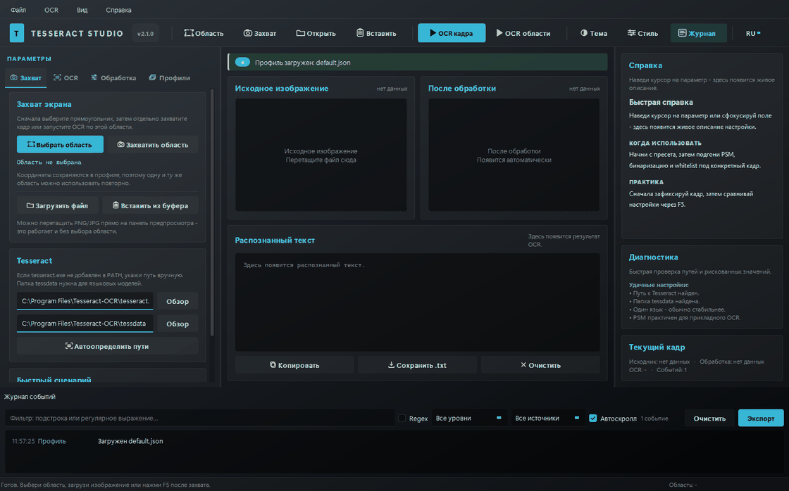
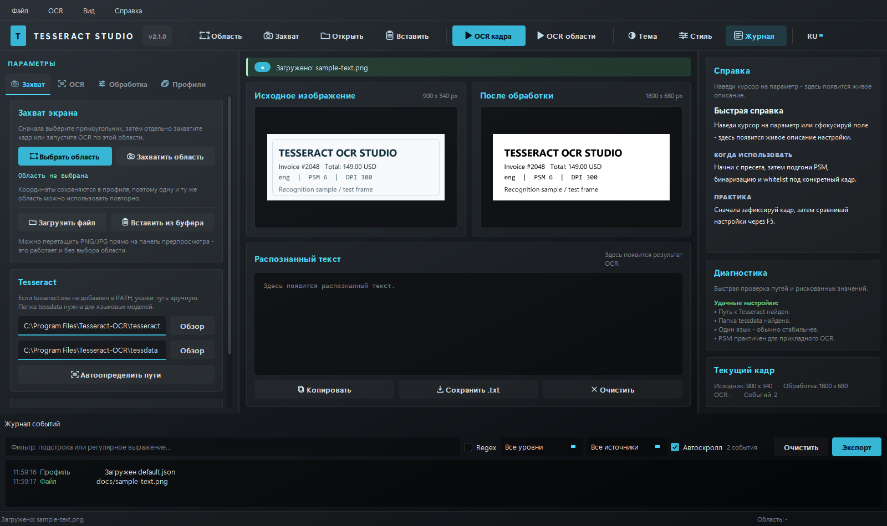
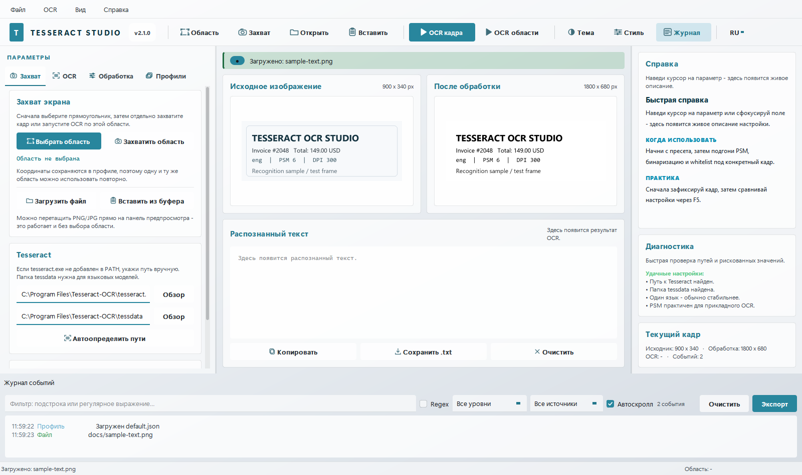

<p align="center">
  
</p>

# Tesseract OCR Studio

[Русский](#русский) | [English](#english)


**Tesseract OCR Studio** is a desktop OCR workbench for Windows.
It captures a screen region or loads an existing image, previews exactly what
Tesseract will receive after preprocessing, and lets you tune OCR parameters
without restarting the app.

**Tesseract OCR Studio** - настольная OCR-студия для Windows.
Она захватывает область экрана или загружает изображение, показывает, что именно
уйдёт в Tesseract после обработки, и позволяет подбирать параметры OCR без
перезапуска приложения.

The interface is fully bilingual (RU/EN) and the whole OCR workflow lives in one
window: capture, preprocessing, parameters, profiles, diagnostics and an activity
log.

***

## Table of contents

- [Русский](#русский)
- [English](#english)
- [Contributing](#contributing)
- [License](#license)

***

# Русский

## Что это

**Tesseract OCR Studio** - настольная OCR-студия для Windows. Она
захватывает область экрана или загружает изображение, показывает, что именно
уйдёт в Tesseract после обработки, и позволяет подбирать параметры OCR без
перезапуска приложения.

Интерфейс перенесён из проекта **Qt UI Lab**: тёмная и светлая палитра,
градиентная оболочка, плоские карточки, акцентные кнопки, живая справка, журнал
событий и настраиваемое оформление. Весь OCR-функционал исходного монолитного
скрипта сохранён.

## Демонстрация

Загрузка кадра, запуск OCR и полученный результат (реальный Tesseract 5.x):



## Скриншоты

Тёмная тема, русский интерфейс:



Тёмная тема, английский интерфейс:


Светлая тема:



## Возможности

- выбор прямоугольной области экрана мышью (виртуальный рабочий стол, мультимонитор);
- захват области без OCR и повторный OCR по уже зафиксированному кадру;
- загрузка изображения из файла, буфера обмена или перетаскиванием на превью;
- живой предпросмотр исходника и результата предобработки;
- OCR в фоновом потоке, интерфейс не замирает;
- полный русский и английский интерфейс с переключателем языка и флагом `--lang`;
- тёмная и светлая палитры, настраиваемые акцент, радиус и шрифт;
- пресеты OCR: `single_digit_strict`, `digits`, `strict_ui`, `small_text`, `chat_text`;
- профили в `configs/*.json` со всеми параметрами и координатами области;
- контекстная справка по каждому параметру и подсказки по PSM;
- диагностика настроек: рискованные значения и отсутствующие языковые файлы;
- журнал событий с фильтрами, уровнями, автоскроллом и экспортом в CSV/TXT;
- горячие клавиши и меню для всех основных действий;
- один экземпляр приложения: повторный запуск поднимает уже открытое окно.

## Стек технологий

| Слой | Технология |
| - | - |
| Язык | Python 3.10+ |
| GUI | PyQt5 (Qt Widgets), собственная QSS-тема |
| OCR | Tesseract OCR 5.x через `pytesseract` |
| Изображения | OpenCV (`opencv-python`), `numpy` |
| Захват экрана | `mss` |
| Сборка | PyInstaller (`TesseractOCRStudio.spec`) |
| Тесты | pytest, offscreen-платформа Qt |
| CI | GitHub Actions (Windows, Python 3.10/3.12) |

## Структура проекта

```text
tesseract_ocr_studio/
├── main.py                        точка входа
├── requirements.txt               runtime-зависимости
├── requirements-dev.txt           pytest
├── pyproject.toml                 метаданные пакета и pytest
├── LICENSE                        MIT
├── CHANGELOG.md                   история релизов
├── CONTRIBUTING.md                правила разработки и локализации
├── SECURITY.md                    политика безопасности
├── TesseractOCRStudio.spec        сборка PyInstaller
├── README.md                      этот файл (RU/EN)
├── .github/workflows/             CI и сборка релиза по тегу
├── configs/                       профили *.json
├── docs/                          логотип, демо-GIF, скриншоты и тестовый кадр
├── tests/                         pytest: конфиг, OCR, тема, окно, i18n, журнал
└── tesseract_studio/
    ├── __init__.py                версия и метаданные
    ├── app.py                     QApplication, CLI, запуск окна
    ├── i18n.py                    переключатель RU/EN и `tr()`
    ├── translations_en.py         английский каталог строк
    ├── config.py                  AppConfig, пресеты, пути, профили
    ├── ocr.py                     предобработка и вызовы Tesseract
    ├── imaging.py                 конвертация кадров, файлы, screen capture
    ├── worker.py                  OCRWorker в отдельном QThread
    ├── singleton.py               защита от второго экземпляра
    └── ui/
        ├── theme.py               движок темы Qt UI Lab + OCR-селекторы
        ├── icons.py               нарисованные иконки и логотип
        ├── widgets.py             карточки, формы, превью, баннер, tooltip
        ├── help.py                живая справка и rich tooltip
        ├── help_texts.py          русские тексты подсказок
        ├── help_texts_en.py       английские тексты подсказок
        ├── activity.py            журнал событий с фильтрами/экспортом
        ├── appearance.py          инспектор темы (палитра, акцент, радиус, шрифт)
        ├── region_overlay.py      полноэкранный выбор области
        ├── main_window.py         оболочка, меню, тулбар, состояние, логика
        └── pages/
            ├── capture_page.py    область, источники, пути Tesseract
            ├── ocr_page.py        пресеты, PSM/OEM, строгие фильтры
            ├── preprocess_page.py бинаризация, blur, scale, invert
            ├── profiles_page.py   профили и действия
            └── preview_panel.py   превью и вывод OCR
```

## Требования и зависимости

- Python **3.10+** (проверено на 3.12);
- **Tesseract OCR 5.x**, установленный в системе;
- пакеты из `requirements.txt`: `PyQt5`, `numpy`, `opencv-python`, `pytesseract`, `mss`.

Python-зависимости:

```text
PyQt5>=5.15
numpy>=1.24
opencv-python>=4.8
pytesseract>=0.3.10
mss>=9.0
```

## Настройка переменных окружения

Приложение не требует обязательных переменных окружения, но поддерживает
следующие:

| Переменная | Назначение | Значение по умолчанию |
| - | - | - |
| `TESSERACT_STUDIO_CONFIG_DIR` | каталог с профилями `*.json` | `<корень проекта>/configs` |
| `TESSERACT_STUDIO_SETTINGS` | путь к файлу настроек `QSettings` | системные настройки Qt |
| `TESSERACT_STUDIO_LANG` | язык интерфейса при запуске | `ru` |
| `TESSERACT_STUDIO_NO_RESTART` | не перезапускать приложение при смене языка | не задана |
| `TESSDATA_PREFIX` | каталог с файлами `*.traineddata` | определяется автоматически |

Пример для PowerShell:

```powershell
$env:TESSERACT_STUDIO_CONFIG_DIR = "C:\Users\<user>\Documents\tss-profiles"
$env:TESSERACT_STUDIO_LANG = "en"
python main.py
```

Если приложение установлено как пакет (`pip install .`), профили по умолчанию
хранятся в `%LOCALAPPDATA%\TesseractStudio\configs`, а не внутри `site-packages`.

## Установка и запуск

```bash
git clone https://github.com/Golyb0u/Tesseract_OCR_Studio.git
cd Tesseract_OCR_Studio
python -m venv .venv
.venv\Scripts\activate
pip install -r requirements.txt
python main.py
```

Установка как пакета с console entry point:

```bash
pip install .
tesseract-ocr-studio
```

### Параметры командной строки

Приложение понимает следующие флаги запуска:

| Флаг | Действие |
| - | - |
| `--light` | старт со светлой палитрой |
| `--dark` | старт с тёмной палитрой |
| `--system` | не применять QSS, оставить системный стиль |
| `--profile NAME` | загрузить профиль `configs/NAME.json` |
| `--lang ru\|en` | язык интерфейса |

Пример запуска сразу на английском интерфейсе и с профилем `digits`:

```bash
python main.py --lang en --profile digits
```

Полный список флагов выводит встроенная справка:

```bash
python main.py --help
```

### Настройка Tesseract

1. Установите Tesseract (сборка UB Mannheim для Windows).
2. Проверьте установку:

   ```bash
   tesseract --version
   tesseract --list-langs
   ```

3. Если `tesseract.exe` не в `PATH`, укажите путь на вкладке **Захват -> Tesseract**.
   Типичный путь:

   ```text
   C:\Program Files\Tesseract-OCR\tesseract.exe
   ```

4. Папка `tessdata` обычно лежит рядом:

   ```text
   C:\Program Files\Tesseract-OCR\tessdata
   ```

5. Для русского языка нужен `rus.traineddata`. Если его нет, скачайте файл с
   официального репозитория `tessdata` и положите в `tessdata`. Правая панель
   диагностики покажет, каких файлов не хватает.

### Язык интерфейса

Язык переключается кнопкой `RU` / `EN` в правой части верхней панели или
флагом `--lang`. Выбор сохраняется между запусками. При смене языка приложение
перезапускается, чтобы все страницы, подсказки и диалоги были собраны на выбранном
языке. Английская версия интерфейса полностью переведена: не только меню, но и
справка, диагностика, пресеты и сообщения OCR.

```bash
python main.py --lang en
python main.py --lang ru
```

## Быстрый старт

1. Запустите `python main.py`.
2. Откройте вкладку **Захват** и нажмите **Выбрать область**, выделите прямоугольник.
3. Нажмите **Захватить область** (кадр зафиксируется) или **Загрузить файл**.
4. Перейдите на вкладку **OCR**, выберите пресет и при необходимости поправьте
   `Язык`, `PSM`, `OEM`, `whitelist`.
5. На вкладке **Обработка** проверьте панель **После обработки**, именно она
   показывает изображение, которое получит Tesseract.
6. Нажмите **F5** или **Распознать кадр**. Результат появится в блоке
   **Распознанный текст**.
7. Копируйте текст, сохраняйте в `.txt` или правьте прямо в поле вывода.

Для быстрой проверки перетащите `docs/sample-text.png` на панель предпросмотра.

## Интерфейс

- **Верхняя панель** - область, захват, открытие файла, буфер, OCR кадра и области,
  тема, оформление и журнал.
- **Левая панель** - четыре вкладки: `Захват`, `OCR`, `Обработка`, `Профили`.
- **Центр** - исходное изображение, результат обработки и распознанный текст.
- **Правая панель** - живая справка, диагностика и метрики текущего кадра.
- **Нижний док** - журнал событий с фильтрами и экспортом.

## Горячие клавиши

| Клавиши | Действие |
| - | - |
| `Ctrl+Shift+R` | выбрать область |
| `F6` | захватить область |
| `F5` | распознать текущий кадр |
| `Ctrl+Enter` | распознать выбранную область |
| `Ctrl+O` | открыть изображение |
| `Ctrl+Shift+V` | вставить из буфера |
| `Ctrl+Shift+C` | копировать текст |
| `Ctrl+S` | сохранить текст |
| `Ctrl+T` | сменить палитру |
| `Ctrl+,` | оформление |
| `Ctrl+J` | журнал событий |
| `Ctrl+L` | очистить журнал |
| `Ctrl+/` | список горячих клавиш |
| `Esc` | закрыть окно |

## Профили

Профиль - JSON-файл в `configs/`. Он хранит язык, PSM и OEM, параметры
предобработки, whitelist и blacklist, DPI, дополнительные флаги Tesseract и
координаты области.

- выберите профиль в списке и нажмите **Загрузить**;
- введите новое имя и нажмите **Сохранить**;
- **Обновить** перечитывает папку `configs/`;
- **Открыть папку профилей** открывает каталог в проводнике.

Имена профилей очищаются от символов пути, поэтому запись за пределы `configs/`
невозможна.

## Примеры использования

Пример запуска из кода с заданными параметрами запуска:

```python
from tesseract_studio.app import main

# Запуск в английском интерфейсе с загрузкой профиля "digits"
raise SystemExit(main(["--lang", "en", "--profile", "digits"]))
```

Пример вызова OCR-модуля напрямую:

```python
import cv2

from tesseract_studio.ocr import recognize

settings = {
    "scale": 3.0,
    "grayscale": True,
    "blur_kernel": 0,
    "threshold_mode": "otsu",
    "threshold_value": 150,
    "adaptive_block_size": 31,
    "adaptive_c": 8,
    "invert": False,
    "language": "eng",
    "psm": 6,
    "oem": 3,
    "whitelist": "",
    "blacklist": "",
    "preserve_spaces": False,
    "user_defined_dpi": 300,
    "min_confidence": 0,
    "tesseract_path": "",
    "tessdata_dir": "",
}

frame = cv2.imread("docs/sample-text.png")
processed, text = recognize(frame, settings)
print(text)
```

Пример чтения и сохранения профиля:

```python
from tesseract_studio.config import CONFIG_DIR, load_config_file, save_config_file

profile = load_config_file(CONFIG_DIR / "default.json")
profile.scale = 3.0
save_config_file(CONFIG_DIR / "my-profile.json", profile)
```

## Сборка и тесты

Тесты:

```bash
pip install -r requirements-dev.txt
pytest tests -q
```

Тесты работают в offscreen-режиме и используют временные каталоги для профилей
и `QSettings`, поэтому не трогают реальные настройки. Проверяются пресеты и
конфиг, предобработка изображений, контракт темы, сборка окна, переключение
палитры, профили, журнал событий и полнота RU/EN-перевода (включая справку,
пресеты и PSM-подсказки).

Сборка исполняемого файла:

```bash
pip install pyinstaller
pyinstaller TesseractOCRStudio.spec
```

Готовый файл появится в `dist/TesseractOCRStudio.exe`. Папка `configs`
включается в сборку. Сам Tesseract в exe не входит, его нужно установить
отдельно.

CI запускает тесты на Windows для Python 3.10 и 3.12, а workflow
`release.yml` по тегу `v*` собирает exe, упаковывает ZIP и публикует GitHub
Release.

## Ограничения и известные проблемы

- приложение поддерживает только Windows, на других платформах не тестируется и
  не собирается;
- Tesseract OCR должен быть установлен отдельно, в сборку exe он не входит;
- `dist/` не коммитится: GitHub ограничивает размер файла в репозитории
  (25 МБ через web, 100 МБ через push). Готовые сборки публикуются как assets
  GitHub Release;
- при масштабе Windows 125-150% координаты выбранной области могут смещаться,
  область нужно выбирать заново;
- OCR выполняется только для одной области или одного кадра за раз;
- переключение языка перезапускает приложение, несохранённый вывод может
  потеряться.

Частые проблемы:

| Проблема | Решение |
| - | - |
| `Tesseract не найден` | укажите `tesseract.exe` на вкладке **Захват** или добавьте в `PATH` |
| `В tessdata нет rus.traineddata` | скачайте `rus.traineddata` в `tessdata` или выберите `eng` |
| OCR возвращает мусор | проверьте **После обработки**, PSM, масштаб и `whitelist` |
| Область со смещением | при масштабе Windows 125-150% выберите область заново |
| Текст слишком мелкий | увеличьте `scale` до 2.0-4.0 и DPI до 300 |
| Журнал пуст | откройте док **Журнал событий** (`Ctrl+J`) |

## Roadmap

- [x] Двуязычный интерфейс RU/EN
- [x] Тёмная и светлая темы с инспектором оформления
- [x] Профили и пресеты OCR
- [x] Журнал событий с экспортом
- [x] CI и автоматическая сборка релизов
- [ ] Пакетная обработка нескольких файлов
- [ ] Сохранение результатов OCR в PDF и DOCX
- [ ] Распознавание с видеопотока
- [ ] Плагины пользовательских предобработчиков
- [ ] Поддержка дополнительных языков интерфейса

## Автор и контакты

- Автор и мейнтейнер: **Golyb0u**
- GitHub: <https://github.com/Golyb0u>
- Репозиторий: <https://github.com/Golyb0u/Tesseract_OCR_Studio>
- Релизы: <https://github.com/Golyb0u/Tesseract_OCR_Studio/releases>
- Issues и баги: <https://github.com/Golyb0u/Tesseract_OCR_Studio/issues>
- Discussions: <https://github.com/Golyb0u/Tesseract_OCR_Studio/discussions>

***

# English

## What it is

**Tesseract OCR Studio** is a desktop OCR workbench for Windows.
It captures a screen region or loads an existing image, previews exactly what
Tesseract will receive after preprocessing, and lets you tune OCR parameters
without restarting the app.

The GUI is ported from **Qt UI Lab**: a layered dark and light shell, flat cards,
accent buttons, live help, an activity console and a live appearance inspector.
All OCR behaviour from the original monolithic script is preserved.

## Demo

Loading a frame, running OCR and the resulting output (real Tesseract 5.x):


## Screenshots

Dark theme, Russian interface:


Dark theme, English interface:


Light theme:


## Features

- mouse region selection across the virtual desktop, multi-monitor aware;
- capture-only and re-run OCR on the same frame;
- load images from a file, the clipboard, or drag-and-drop onto the preview;
- live source and processed-image previews;
- OCR runs on a worker thread, so the UI stays responsive;
- dark and light palettes with configurable accent, corner radius and typeface;
- OCR presets: `single_digit_strict`, `digits`, `strict_ui`, `small_text`, `chat_text`;
- JSON profiles in `configs/` including the capture region;
- contextual help for every parameter and PSM hints;
- diagnostics for risky values and missing `.traineddata` files;
- complete Russian and English interface with a toolbar language selector and `--lang`;
- activity log with level and source filters plus CSV and TXT export;
- keyboard shortcuts and menus for every main action;
- single instance: a second launch raises the window that is already open.

## Tech stack

| Layer | Technology |
| - | - |
| Language | Python 3.10+ |
| GUI | PyQt5 (Qt Widgets) with a custom QSS theme |
| OCR | Tesseract OCR 5.x through `pytesseract` |
| Imaging | OpenCV (`opencv-python`), `numpy` |
| Screen capture | `mss` |
| Packaging | PyInstaller (`TesseractOCRStudio.spec`) |
| Tests | pytest with the Qt offscreen platform |
| CI | GitHub Actions (Windows, Python 3.10/3.12) |

## Project layout

```text
tesseract_ocr_studio/
├── main.py                        entry point
├── requirements.txt               runtime dependencies
├── requirements-dev.txt           pytest
├── pyproject.toml                 package metadata and pytest config
├── LICENSE                        MIT
├── CHANGELOG.md                   release history
├── CONTRIBUTING.md                development and localization guide
├── SECURITY.md                    security policy
├── TesseractOCRStudio.spec        PyInstaller build
├── README.md                      this bilingual guide
├── .github/workflows/             CI and tag-driven release build
├── configs/                       *.json profiles
├── docs/                          logo, demo GIF, screenshots and a sample image
├── tests/                         pytest: config, OCR, theme, window, i18n, log
└── tesseract_studio/
    ├── __init__.py                package metadata
    ├── app.py                     QApplication, CLI, window bootstrap
    ├── i18n.py                    RU/EN switch and `tr()`
    ├── translations_en.py         English string catalogue
    ├── config.py                  AppConfig, presets, paths, profiles
    ├── ocr.py                     preprocessing and Tesseract calls
    ├── imaging.py                 image conversion, file IO, screen capture
    ├── worker.py                  OCRWorker on a QThread
    ├── singleton.py               single instance guard
    └── ui/
        ├── theme.py               Qt UI Lab theme engine + OCR selectors
        ├── icons.py               painted line icons and app logo
        ├── widgets.py             cards, form rows, preview, banner, tooltip
        ├── help.py                live help and rich tooltips
        ├── help_texts.py          Russian contextual copy
        ├── help_texts_en.py       English contextual copy
        ├── activity.py            filtered activity console
        ├── appearance.py          palette, accent, radius and font inspector
        ├── region_overlay.py      full-screen region selector
        ├── main_window.py         shell, menus, toolbar, state, orchestration
        └── pages/
            ├── capture_page.py    region, sources, Tesseract paths
            ├── ocr_page.py        presets, PSM/OEM, strict filters
            ├── preprocess_page.py threshold, blur, scale, invert
            ├── profiles_page.py   profile management and actions
            └── preview_panel.py   previews and OCR output
```

## Requirements and dependencies

- Python **3.10+** (tested on 3.12);
- **Tesseract OCR 5.x** installed on the system;
- packages from `requirements.txt`: `PyQt5`, `numpy`, `opencv-python`, `pytesseract`, `mss`.

Python dependencies:

```text
PyQt5>=5.15
numpy>=1.24
opencv-python>=4.8
pytesseract>=0.3.10
mss>=9.0
```

## Environment variables

No environment variable is required, but the following are supported:

| Variable | Purpose | Default |
| - | - | - |
| `TESSERACT_STUDIO_CONFIG_DIR` | directory with `*.json` profiles | `<project root>/configs` |
| `TESSERACT_STUDIO_SETTINGS` | path to the `QSettings` file | system Qt settings |
| `TESSERACT_STUDIO_LANG` | interface language at startup | `ru` |
| `TESSERACT_STUDIO_NO_RESTART` | do not restart the app when the language changes | unset |
| `TESSDATA_PREFIX` | directory with `*.traineddata` files | auto-detected |

PowerShell example:

```powershell
$env:TESSERACT_STUDIO_CONFIG_DIR = "C:\Users\<user>\Documents\tss-profiles"
$env:TESSERACT_STUDIO_LANG = "en"
python main.py
```

When the application is installed as a package (`pip install .`), profiles are
stored in `%LOCALAPPDATA%\TesseractStudio\configs` instead of inside
`site-packages`.

## Install and run

```bash
git clone https://github.com/Golyb0u/Tesseract_OCR_Studio.git
cd Tesseract_OCR_Studio
python -m venv .venv
.venv\Scripts\activate
pip install -r requirements.txt
python main.py
```

Install as a package with a console entry point:

```bash
pip install .
tesseract-ocr-studio
```

### CLI flags

The application understands the following startup flags:

| Flag | Effect |
| - | - |
| `--light` | start with the light palette |
| `--dark` | start with the dark palette |
| `--system` | do not apply QSS, keep the native platform style |
| `--profile NAME` | load `configs/NAME.json` on startup |
| `--lang ru\|en` | interface language |

Example: start directly in English with the `digits` profile loaded.

```bash
python main.py --lang en --profile digits
```

The built-in help lists every supported flag:

```bash
python main.py --help
```

### Tesseract setup

1. Install Tesseract (UB Mannheim build for Windows).
2. Verify it:

   ```bash
   tesseract --version
   tesseract --list-langs
   ```

3. If `tesseract.exe` is not on `PATH`, set the path on the **Capture** tab.
   Typical Windows path:

   ```text
   C:\Program Files\Tesseract-OCR\tesseract.exe
   ```

4. The `tessdata` folder is usually next to it:

   ```text
   C:\Program Files\Tesseract-OCR\tessdata
   ```

5. Russian OCR requires `rus.traineddata` inside `tessdata`. Download it from the
   official `tessdata` repository if it is missing, diagnostics will list missing files.

### Interface language

Switch the language with the `RU` / `EN` button in the right part of the toolbar
or with `--lang`. The choice is saved between launches. Changing the language
restarts the application so every page, help text and dialog is rebuilt in the
selected language. The English build is fully translated: menus, help,
diagnostics, presets and OCR messages.

```bash
python main.py --lang en
python main.py --lang ru
```

## Quick start

1. Run `python main.py`.
2. Open the **Capture** tab and click **Select region**, then drag a rectangle.
3. Click **Capture** to freeze a frame, or **Open file**.
4. Open **OCR**, pick a preset, and adjust language, PSM, OEM and whitelist.
5. Open **Preprocess** and check **Processed**, that is exactly what Tesseract
   will see.
6. Press **F5** or **Run OCR**. The text appears in the output card.
7. Copy it, save it as `.txt`, or edit it directly.

To try it quickly, drag `docs/sample-text.png` onto the preview.

## UI overview

- **Toolbar** - region, capture, open, paste, OCR frame and region, theme,
  appearance, log.
- **Left panel** - `Capture`, `OCR`, `Preprocess`, `Profiles`.
- **Center** - source image, processed image, recognised text.
- **Right panel** - live help, diagnostics, current-frame metrics.
- **Bottom dock** - activity log with filters and export.

## Keyboard shortcuts

| Keys | Action |
| - | - |
| `Ctrl+Shift+R` | select region |
| `F6` | capture region |
| `F5` | OCR the current frame |
| `Ctrl+Enter` | OCR the selected region |
| `Ctrl+O` | open image |
| `Ctrl+Shift+V` | paste from clipboard |
| `Ctrl+Shift+C` | copy recognised text |
| `Ctrl+S` | save text |
| `Ctrl+T` | toggle palette |
| `Ctrl+,` | appearance |
| `Ctrl+J` | activity log |
| `Ctrl+L` | clear log |
| `Ctrl+/` | shortcut list |
| `Esc` | close window |

## Profiles

A profile is a JSON file in `configs/`. It stores the language, PSM and OEM, all
preprocessing values, whitelist and blacklist, DPI, extra Tesseract flags and
the capture region.

- select a profile and click **Load**;
- type a new name and click **Save**;
- **Refresh** re-reads `configs/`;
- **Open profiles folder** opens the directory in the file manager.

Profile names are sanitised, so they cannot escape the `configs/` directory.

## Usage examples

Launch the app from code with explicit startup options:

```python
from tesseract_studio.app import main

# Start in English and load the "digits" profile
raise SystemExit(main(["--lang", "en", "--profile", "digits"]))
```

Call the OCR module directly:

```python
import cv2

from tesseract_studio.ocr import recognize

settings = {
    "scale": 3.0,
    "grayscale": True,
    "blur_kernel": 0,
    "threshold_mode": "otsu",
    "threshold_value": 150,
    "adaptive_block_size": 31,
    "adaptive_c": 8,
    "invert": False,
    "language": "eng",
    "psm": 6,
    "oem": 3,
    "whitelist": "",
    "blacklist": "",
    "preserve_spaces": False,
    "user_defined_dpi": 300,
    "min_confidence": 0,
    "tesseract_path": "",
    "tessdata_dir": "",
}

frame = cv2.imread("docs/sample-text.png")
processed, text = recognize(frame, settings)
print(text)
```

Read and write a profile:

```python
from tesseract_studio.config import CONFIG_DIR, load_config_file, save_config_file

profile = load_config_file(CONFIG_DIR / "default.json")
profile.scale = 3.0
save_config_file(CONFIG_DIR / "my-profile.json", profile)
```

## Build and tests

Tests:

```bash
pip install -r requirements-dev.txt
pytest tests -q
```

Tests run offscreen and use temporary profile and settings directories, so they do
not touch your real configuration. They cover configuration and presets, image
preprocessing, the theme contract, window construction, palette switching,
profile round-trips, the activity console and full RU/EN localization (including
help, presets and PSM hints).

Build the executable:

```bash
pip install pyinstaller
pyinstaller TesseractOCRStudio.spec
```

The executable is written to `dist/TesseractOCRStudio.exe`. The `configs` folder
is bundled, but user profiles are easier to manage next to the executable.
Tesseract itself is not bundled and must be installed separately.

CI runs the test suite on Windows for Python 3.10 and 3.12, and the
`release.yml` workflow builds the exe, creates a ZIP and publishes a GitHub
Release on a `v*` tag.

## Limitations and known issues

- only Windows is supported, the application is not tested or built on other
  platforms;
- Tesseract OCR must be installed separately, it is not bundled into the exe;
- `dist/` is not committed: GitHub caps repository file size (25 MB via web,
  100 MB via push). Ready builds are published as GitHub Release assets;
- at 125-150% Windows scaling the selected region may be offset, select it again;
- OCR handles a single region or a single frame at a time;
- switching the language restarts the application, unsaved output may be lost.

Troubleshooting:

| Problem | Fix |
| - | - |
| `Tesseract not found` | set `tesseract.exe` on the Capture tab or add it to `PATH` |
| `rus.traineddata` missing | download `rus.traineddata` into `tessdata`, or use `eng` |
| OCR output is garbage | inspect **Processed**, then tune PSM, scale and whitelist |
| Region is offset | at 125-150% Windows scaling, select the region again |
| Text is too small | raise `scale` to 2.0-4.0 and DPI to 300 |
| Activity log stays empty | make sure the dock is open (`Ctrl+J`) |

## Roadmap

- [x] Bilingual RU/EN interface
- [x] Dark and light themes with an appearance inspector
- [x] OCR presets and profiles
- [x] Activity log with export
- [x] CI and automated release builds
- [ ] Batch processing of multiple files
- [ ] Export of OCR results to PDF and DOCX
- [ ] Recognition from a video stream
- [ ] Plugins for custom preprocessors
- [ ] Additional interface languages

## Author and contacts

- Author and maintainer: **Golyb0u**
- GitHub: <https://github.com/Golyb0u>
- Repository: <https://github.com/Golyb0u/Tesseract_OCR_Studio>
- Releases: <https://github.com/Golyb0u/Tesseract_OCR_Studio/releases>
- Issues and bugs: <https://github.com/Golyb0u/Tesseract_OCR_Studio/issues>
- Discussions: <https://github.com/Golyb0u/Tesseract_OCR_Studio/discussions>

***

## Contributing

See [CONTRIBUTING.md](CONTRIBUTING.md) for the development setup, the localization
rules and the release checklist. Security issues are handled as described in
[SECURITY.md](SECURITY.md).

## License

MIT. See [LICENSE](LICENSE).
