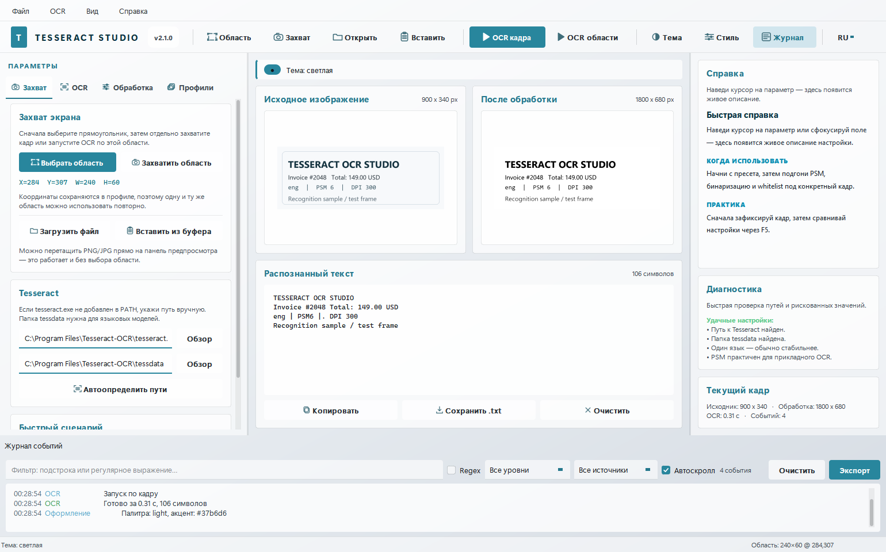
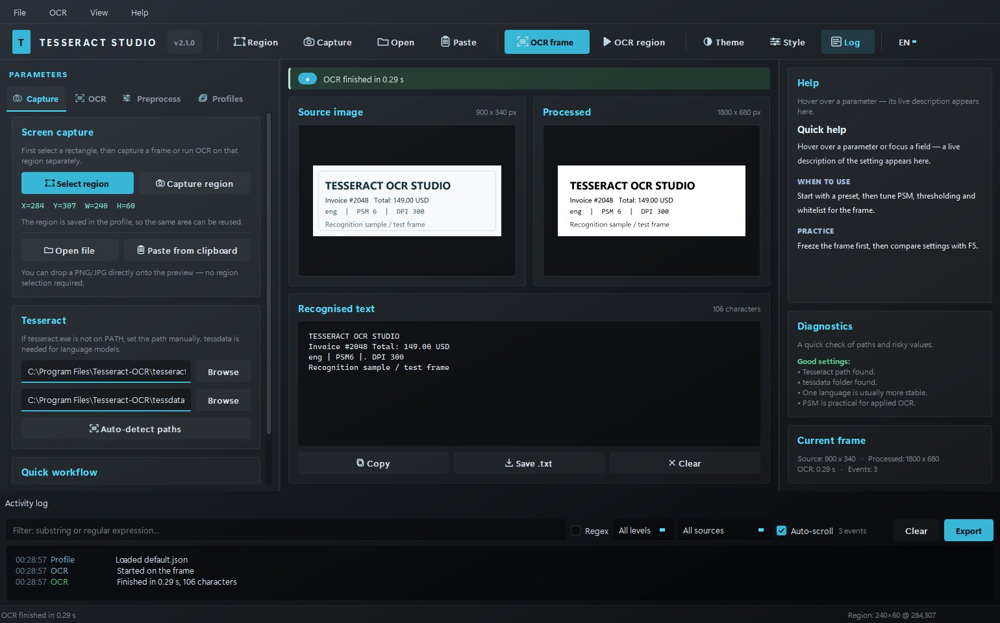

# Tesseract OCR Studio 2.1.0

[Русский](#русский) · [English](#english) · [Release / Релиз](#release--релиз)


PyQt5-студия OCR для Tesseract. GUI перенесён из **Qt UI Lab**: слоистая
«стеклянная» оболочка, живая тема, нарисованные индикаторы, журнал событий и
компактный трёхколоночный рабочий процесс.

---

## Русский

### Что это

**Tesseract OCR Studio** — настольная OCR-студия для Windows/Linux/macOS. Она
захватывает область экрана или загружает изображение, показывает, что именно
уйдёт в Tesseract после обработки, и позволяет подбирать параметры OCR без
перезапуска приложения.

Интерфейс перенесён из проекта `qt_ui_lab` (Qt UI Lab): тёмная/светлая палитра,
градиентная оболочка, плоские карточки, акцентные кнопки, живая справка, журнал
событий и настраиваемое оформление. Весь OCR-функционал исходного `app.py`
сохранён.

### Возможности

- выбор прямоугольной области экрана мышью (виртуальный рабочий стол, мультимонитор);
- захват области без OCR и повторный OCR по уже зафиксированному кадру;
- загрузка изображения из файла, буфера обмена или перетаскиванием на превью;
- живой предпросмотр исходника и результата предобработки;
- OCR в фоновом потоке — интерфейс не замирает;
- полный русский и английский интерфейс с переключателем языка и флагом `--lang`;
- тёмная и светлая палитры, настраиваемые акцент, радиус и шрифт;
- пресеты OCR: `single_digit_strict`, `digits`, `strict_ui`, `small_text`, `chat_text`;
- профили в `configs/*.json` со всеми параметрами и координатами области;
- контекстная справка по каждому параметру и подсказки по PSM;
- диагностика настроек: рискованные значения и отсутствующие языковые файлы;
- журнал событий с фильтрами, уровнями, автоскроллом и экспортом в CSV/TXT;
- горячие клавиши и меню для всех основных действий.

### Требования

- Python **3.10+** (проверено на 3.12);
- **Tesseract OCR 5.x**;
- пакеты из `requirements.txt`: `PyQt5`, `numpy`, `opencv-python`, `pytesseract`, `mss`.

### Установка и запуск

```bash
cd tesseract_ocr_studio
python -m venv .venv
.venv\Scripts\activate        # Windows
# source .venv/bin/activate   # Linux / macOS
pip install -r requirements.txt
python main.py
```

Старый запуск тоже работает:

```bash
python app.py
```

Параметры командной строки:

| Флаг | Действие |
|---|---|
| `--light` | старт со светлой палитрой |
| `--dark` | старт с тёмной палитрой |
| `--system` | не применять QSS, оставить системный стиль |
| `--profile NAME` | загрузить профиль `configs/NAME.json` |
| `--lang ru\|en` | язык интерфейса |

### Язык интерфейса

Язык переключается кнопкой `RU` / `EN` в правой части верхней панели или
флагом `--lang`. Выбор сохраняется между запусками. При смене языка приложение
перезапускается, чтобы все страницы, подсказки и диалоги были собраны на выбранном
языке. Английская версия интерфейса полностью переведена — не только меню, но и
справка, диагностика, пресеты и сообщения OCR.

```bash
python main.py --lang en
python main.py --lang ru
```

### Настройка Tesseract

1. Установите Tesseract (на Windows — сборка UB Mannheim, на Linux —
   `apt install tesseract-ocr tesseract-ocr-rus`).
2. Проверьте установку:

   ```bash
   tesseract --version
   tesseract --list-langs
   ```

3. Если `tesseract.exe` не в `PATH`, укажите путь на вкладке **Захват → Tesseract**.
   Типичный путь:

   ```text
   C:\Program Files\Tesseract-OCR\tesseract.exe
   ```

4. Папка `tessdata` обычно лежит рядом:

   ```text
   C:\Program Files\Tesseract-OCR\tessdata
   ```

5. Для русского языка нужен `rus.traineddata`. Если его нет, скачайте файл с
   официального репозитория `tessdata` и положите в `tessdata`. Правая панель
   диагностики покажет, каких файлов не хватает.

### Быстрый старт

1. Запустите `python main.py`.
2. Откройте вкладку **Захват** → **Выбрать область** и выделите прямоугольник.
3. Нажмите **Захватить область** (кадр зафиксируется) или **Загрузить файл**.
4. Перейдите на вкладку **OCR**, выберите пресет и при необходимости поправьте
   `Язык`, `PSM`, `OEM`, `whitelist`.
5. На вкладке **Обработка** проверьте панель **После обработки** — именно она
   показывает изображение, которое получит Tesseract.
6. Нажмите **F5** или **Распознать кадр**. Результат появится в блоке
   **Распознанный текст**.
7. Копируйте текст, сохраняйте в `.txt` или правьте прямо в поле вывода.

Для быстрой проверки перетащите `docs/sample-text.png` на панель предпросмотра.

### Интерфейс

- **Верхняя панель** — область, захват, открытие файла, буфер, OCR кадра/области,
  тема, оформление и журнал.
- **Левая панель** — четыре вкладки: `Захват`, `OCR`, `Обработка`, `Профили`.
- **Центр** — исходное изображение, результат обработки и распознанный текст.
- **Правая панель** — живая справка, диагностика и метрики текущего кадра.
- **Нижний док** — журнал событий с фильтрами и экспортом.



### Горячие клавиши

| Клавиши | Действие |
|---|---|
| `Ctrl+Shift+R` | выбрать область |
| `F6` | захватить область |
| `F5` | распознать текущий кадр |
| `Ctrl+Enter` | распознать выбранную область |
| `Ctrl+O` | открыть изображение |
| `Ctrl+Shift+V` | вставить из буфера |
| `Ctrl+Shift+C` | копировать текст |
| `Ctrl+S` | сохранить текст |
| `Ctrl+T` | сменить палитру |
| `Ctrl+,` | оформление |
| `Ctrl+J` | журнал событий |
| `Ctrl+L` | очистить журнал |
| `Ctrl+/` | список горячих клавиш |
| `Esc` | закрыть окно |

### Профили

Профиль — JSON-файл в `configs/`. Он хранит язык, PSM/OEM, параметры
предобработки, whitelist/blacklist, DPI, дополнительные флаги Tesseract и
координаты области.

- выберите профиль в списке и нажмите **Загрузить**;
- введите новое имя и нажмите **Сохранить**;
- **Обновить** перечитывает папку `configs/`;
- **Открыть папку профилей** открывает каталог в проводнике.

Имена профилей очищаются от символов пути, поэтому запись за пределы `configs/`
невозможна.

### Структура проекта

```text
tesseract_ocr_studio/
├── main.py                        новая точка входа
├── app.py                         совместимый вход для `python app.py`
├── requirements.txt               runtime-зависимости
├── requirements-dev.txt           pytest
├── pyproject.toml                 метаданные пакета и pytest
├── LICENSE                        MIT
├── CHANGELOG.md                   история релизов
├── CONTRIBUTING.md                правила разработки и локализации
├── TesseractOCRStudio.spec        сборка PyInstaller
├── README.md                      этот файл (RU/EN)
├── .github/workflows/             CI и сборка релиза по тегу
├── configs/                       профили *.json
├── docs/                          скриншоты и тестовый кадр
├── tests/                         pytest: конфиг, OCR, тема, окно, i18n, журнал
└── tesseract_studio/
    ├── __init__.py                версия и метаданные
    ├── app.py                     QApplication, CLI, запуск окна
    ├── i18n.py                    переключатель RU/EN и `tr()`
    ├── translations_en.py         английский каталог строк
    ├── config.py                  AppConfig, пресеты, пути, профили
    ├── ocr.py                     предобработка и вызовы Tesseract
    ├── imaging.py                 конвертация кадров, файлы, screen capture
    ├── worker.py                  OCRWorker в отдельном QThread
    └── ui/
        ├── theme.py               движок темы Qt UI Lab + OCR-селекторы
        ├── icons.py               нарисованные иконки и логотип
        ├── widgets.py             карточки, формы, превью, баннер, tooltip
        ├── help.py                живая справка и rich tooltip
        ├── help_texts.py          русские тексты подсказок
        ├── help_texts_en.py       английские тексты подсказок
        ├── activity.py            журнал событий с фильтрами/экспортом
        ├── appearance.py          инспектор темы (палитра, акцент, радиус, шрифт)
        ├── region_overlay.py      полноэкранный выбор области
        ├── main_window.py         оболочка, меню, тулбар, состояние, логика
        └── pages/
            ├── capture_page.py    область, источники, пути Tesseract
            ├── ocr_page.py        пресеты, PSM/OEM, строгие фильтры
            ├── preprocess_page.py бинаризация, blur, scale, invert
            ├── profiles_page.py   профили и действия
            └── preview_panel.py   превью и вывод OCR
```

`dist/` содержит локальную сборку 2.1.0 (`TesseractOCRStudio.exe` и
`TesseractOCRStudio-windows.zip`); GitHub workflow пересобирает её по тегу.

### Тесты

```bash
pip install -r requirements-dev.txt
pytest tests -q
```

Тесты работают в offscreen-режиме и используют временные каталоги для профилей
и `QSettings`, поэтому не трогают реальные настройки. Проверяются пресеты и
конфиг, предобработка изображений, контракт темы, сборка окна, переключение
палитры, профили, журнал событий и полнота RU/EN-перевода (включая справку,
пресеты и PSM-подсказки).

### Сборка EXE

```bash
pip install pyinstaller
pyinstaller TesseractOCRStudio.spec
```

Готовый файл появится в `dist/TesseractOCRStudio.exe`. Папка `configs`
включается в сборку.

### Частые проблемы

| Проблема | Решение |
|---|---|
| `Tesseract не найден` | укажите `tesseract.exe` на вкладке **Захват** или добавьте в `PATH` |
| `В tessdata нет rus.traineddata` | скачайте `rus.traineddata` в `tessdata` или выберите `eng` |
| OCR возвращает мусор | проверьте **После обработки**, PSM, масштаб и `whitelist` |
| Область со смещением | при масштабе Windows 125–150% выберите область заново |
| Текст слишком мелкий | увеличьте `scale` до 2.0–4.0 и DPI до 300 |
| Журнал пуст | откройте док **Журнал событий** (`Ctrl+J`) |

### Перенос GUI из Qt UI Lab

Перенесены и адаптированы: токенизированный QSS-движок `theme.py` (включая
светлую палитру и painted-индикаторы), оболочка с градиентом и плоскими
карточками, инспектор оформления, журнал событий, rich tooltip / контекстная
справка, статусный баннер, чипы, метрики и нижний док. Добавлена полная
RU/EN-локализация: переключатель в тулбаре, флаг `--lang`, перевод справки,
диагностики, пресетов и сообщений OCR.

Исходный монолитный `app.py` разбит на пакет `tesseract_studio`: бизнес-логика
OCR отделена от страниц интерфейса, тема и переиспользуемые виджеты вынесены в
`ui/`.

### Лицензия

MIT. Подробности в `LICENSE`.

---

## English

### What it is

**Tesseract OCR Studio** is a desktop OCR workbench for Windows, Linux and macOS.
It captures a screen region or loads an existing image, previews exactly what
Tesseract will receive after preprocessing, and lets you tune OCR parameters
without restarting the app.

The GUI is ported from **Qt UI Lab**: a layered dark/light shell, flat cards,
accent buttons, live help, an activity console and a live appearance inspector.
All OCR behaviour from the original `app.py` is preserved.

### Features

- mouse region selection across the virtual desktop (multi-monitor aware);
- capture-only and re-run OCR on the same frame;
- load images from a file, the clipboard, or drag-and-drop onto the preview;
- live source and processed-image previews;
- OCR runs on a worker thread, so the UI stays responsive;
- dark/light palettes with configurable accent, corner radius and typeface;
- OCR presets: `single_digit_strict`, `digits`, `strict_ui`, `small_text`, `chat_text`;
- JSON profiles in `configs/` including the capture region;
- contextual help for every parameter and PSM hints;
- diagnostics for risky values and missing `.traineddata` files;
- complete Russian and English interface with a toolbar language selector and `--lang`;
- activity log with level/source/text filters and CSV/TXT export;
- keyboard shortcuts and menus for every main action.



### Requirements

- Python **3.10+** (tested on 3.12);
- **Tesseract OCR 5.x**;
- packages from `requirements.txt`: `PyQt5`, `numpy`, `opencv-python`, `pytesseract`, `mss`.

### Install and run

```bash
cd tesseract_ocr_studio
python -m venv .venv
.venv\Scripts\activate        # Windows
# source .venv/bin/activate   # Linux / macOS
pip install -r requirements.txt
python main.py
```

The legacy command still works:

```bash
python app.py
```

CLI flags:

| Flag | Effect |
|---|---|
| `--light` | start with the light palette |
| `--dark` | start with the dark palette |
| `--system` | do not apply QSS; keep the native platform style |
| `--profile NAME` | load `configs/NAME.json` on startup |
| `--lang ru\|en` | interface language |

### Interface language

Switch the language with the `RU` / `EN` button in the right part of the toolbar
or with `--lang`. The choice is saved between launches. Changing the language
restarts the application so every page, help text and dialog is rebuilt in the
selected language. The English build is fully translated: menus, help,
diagnostics, presets and OCR messages.

```bash
python main.py --lang en
python main.py --lang ru
```

### Tesseract setup

1. Install Tesseract (UB Mannheim build on Windows, or your package manager on Linux/macOS).
2. Verify it:

   ```bash
   tesseract --version
   tesseract --list-langs
   ```

3. If `tesseract.exe` is not on `PATH`, set the path on the **Захват / Capture** tab.
   Typical Windows path:

   ```text
   C:\Program Files\Tesseract-OCR\tesseract.exe
   ```

4. The `tessdata` folder is usually next to it:

   ```text
   C:\Program Files\Tesseract-OCR\tessdata
   ```

5. Russian OCR requires `rus.traineddata` inside `tessdata`. Download it from the
   official `tessdata` repository if it is missing; diagnostics will list missing files.

### Quick start

1. Run `python main.py`.
2. Open **Захват / Capture** → **Выбрать область / Select region** and drag a rectangle.
3. Click **Захватить область / Capture** to freeze a frame, or **Загрузить файл / Open file**.
4. Open **OCR**, pick a preset, and adjust language, PSM, OEM and whitelist.
5. Open **Обработка / Preprocess** and check **После обработки / Processed** — that is
   exactly what Tesseract will see.
6. Press **F5** or **Распознать кадр / Run OCR**. The text appears in the output card.
7. Copy it, save it as `.txt`, or edit it directly.

To try it quickly, drag `docs/sample-text.png` onto the preview.

### UI overview

- **Toolbar** — region, capture, open, paste, OCR frame/region, theme, appearance, log.
- **Left panel** — `Capture`, `OCR`, `Preprocess`, `Profiles`.
- **Center** — source image, processed image, recognised text.
- **Right panel** — live help, diagnostics, current-frame metrics.
- **Bottom dock** — activity log with filters and export.


### Keyboard shortcuts

| Keys | Action |
|---|---|
| `Ctrl+Shift+R` | select region |
| `F6` | capture region |
| `F5` | OCR the current frame |
| `Ctrl+Enter` | OCR the selected region |
| `Ctrl+O` | open image |
| `Ctrl+Shift+V` | paste from clipboard |
| `Ctrl+Shift+C` | copy recognised text |
| `Ctrl+S` | save text |
| `Ctrl+T` | toggle palette |
| `Ctrl+,` | appearance |
| `Ctrl+J` | activity log |
| `Ctrl+L` | clear log |
| `Ctrl+/` | shortcut list |
| `Esc` | close window |

### Profiles

A profile is a JSON file in `configs/`. It stores the language, PSM/OEM, all
preprocessing values, whitelist/blacklist, DPI, extra Tesseract flags and the
capture region.

- select a profile and click **Load**;
- type a new name and click **Save**;
- **Refresh** re-reads `configs/`;
- **Open profiles folder** opens the directory in the file manager.

Profile names are sanitised, so they cannot escape the `configs/` directory.

### Project layout

```text
tesseract_ocr_studio/
├── main.py                        new entry point
├── app.py                         compatibility entry for `python app.py`
├── requirements.txt               runtime dependencies
├── requirements-dev.txt           pytest
├── pyproject.toml                 package metadata and pytest config
├── LICENSE                        MIT
├── CHANGELOG.md                   release history
├── CONTRIBUTING.md                development and localization guide
├── TesseractOCRStudio.spec        PyInstaller build
├── README.md                      this bilingual guide
├── .github/workflows/             CI and tag-driven release build
├── configs/                       *.json profiles
├── docs/                          screenshots and a sample image
├── tests/                         pytest: config, OCR, theme, window, i18n, log
└── tesseract_studio/
    ├── __init__.py                package metadata
    ├── app.py                     QApplication, CLI, window bootstrap
    ├── i18n.py                    RU/EN switch and `tr()`
    ├── translations_en.py         English string catalogue
    ├── config.py                  AppConfig, presets, paths, profiles
    ├── ocr.py                     preprocessing and Tesseract calls
    ├── imaging.py                 image conversion, file IO, screen capture
    ├── worker.py                  OCRWorker on a QThread
    └── ui/
        ├── theme.py               Qt UI Lab theme engine + OCR selectors
        ├── icons.py               painted line icons and app logo
        ├── widgets.py             cards, form rows, preview, banner, tooltip
        ├── help.py                live help and rich tooltips
        ├── help_texts.py          Russian contextual copy
        ├── help_texts_en.py       English contextual copy
        ├── activity.py            filtered activity console
        ├── appearance.py          palette/accent/radius/font inspector
        ├── region_overlay.py      full-screen region selector
        ├── main_window.py         shell, menus, toolbar, state, orchestration
        └── pages/
            ├── capture_page.py    region, sources, Tesseract paths
            ├── ocr_page.py        presets, PSM/OEM, strict filters
            ├── preprocess_page.py threshold, blur, scale, invert
            ├── profiles_page.py   profile management and actions
            └── preview_panel.py   previews and OCR output
```

`dist/` contains a local 2.1.0 build (`TesseractOCRStudio.exe` and
`TesseractOCRStudio-windows.zip`); the GitHub workflow rebuilds it on a tag.

### Tests

```bash
pip install -r requirements-dev.txt
pytest tests -q
```

Tests run offscreen and use temporary profile/QSettings directories, so they do
not touch your real configuration. They cover configuration and presets, image
preprocessing, the theme contract, window construction, palette switching,
profile round-trips, the activity console and full RU/EN localization (including
help, presets and PSM hints).

### Build the EXE

```bash
pip install pyinstaller
pyinstaller TesseractOCRStudio.spec
```

The executable is written to `dist/TesseractOCRStudio.exe`. The `configs` folder
is bundled, but user profiles are easier to manage next to the executable.

### Troubleshooting

| Problem | Fix |
|---|---|
| `Tesseract не найден` | set `tesseract.exe` on the Capture tab or add it to `PATH` |
| `В tessdata нет rus.traineddata` | download `rus.traineddata` into `tessdata`, or use `eng` |
| OCR output is garbage | inspect **Processed**, then tune PSM, scale and whitelist |
| Region is offset | at 125–150% Windows scaling, select the region again |
| Text is too small | raise `scale` to 2.0–4.0 and DPI to 300 |
| Activity log stays empty | make sure the dock is open (`Ctrl+J`) |

### GUI port notes

Ported and adapted from Qt UI Lab:

- the token-based QSS engine (`theme.py`), including the light palette and painted indicators;
- the gradient shell, flat cards, accent buttons and toolbar;
- the live appearance inspector (accent, radius, typeface, palette);
- the filterable/exportable activity console;
- rich tooltips and contextual help;
- the status banner, chips, metrics and bottom dock;
- full RU/EN localization with a toolbar selector, `--lang` flag and translated
  help, diagnostics, presets and OCR messages.

The original monolithic `app.py` is split into the `tesseract_studio` package:
OCR business logic is independent from the UI pages, while the theme and reusable
widgets live under `ui/`.

### Release / Релиз

**Русский**

Проект подготовлен к публикации на GitHub:

- `LICENSE` — MIT;
- `.github/workflows/ci.yml` — тесты на Windows и Ubuntu для Python 3.10/3.12;
- `.github/workflows/release.yml` — по тегу `v*` собирает `TesseractOCRStudio.exe`,
  упаковывает ZIP и публикует GitHub Release;
- `pyproject.toml` — метаданные пакета, зависимости и console entry point;
- `CHANGELOG.md` и `CONTRIBUTING.md` — история версий и правила разработки.

Порядок релиза:

```bash
git init
git add .
git commit -m "Release 2.1.0: RU/EN localization and GitHub release setup"
git branch -M main
git remote add origin https://github.com/<owner>/<repo>.git
git push -u origin main
git tag -a v2.1.0 -m "Tesseract OCR Studio 2.1.0"
git push origin v2.1.0
```

После пуша тега workflow соберёт Windows-релиз. Сам Tesseract в exe не
входит — его нужно установить отдельно (см. раздел настройки).

**English**

The repository is release-ready:

- `LICENSE` (MIT), `CHANGELOG.md`, `CONTRIBUTING.md`, `pyproject.toml`;
- CI runs the test suite on Windows and Ubuntu for Python 3.10/3.12;
- pushing a `v*` tag builds `TesseractOCRStudio.exe`, creates a ZIP and publishes
  a GitHub Release with both assets.

```bash
git init
git add .
git commit -m "Release 2.1.0: RU/EN localization and GitHub release setup"
git branch -M main
git remote add origin https://github.com/<owner>/<repo>.git
git push -u origin main
git tag -a v2.1.0 -m "Tesseract OCR Studio 2.1.0"
git push origin v2.1.0
```

Tesseract itself is not bundled into the executable; install it separately as
described above.

### License

MIT. See `LICENSE`.
